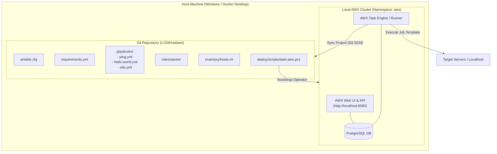

# Ansible AWX Full Stack & Starter Project

Repositori ini adalah template **Full Stack AWX Project** yang siap pakai. Repositori ini memiliki fungsi ganda:
1. **Ansible SCM Project**: Struktur standar repositori Ansible yang dapat dihubungkan langsung ke **Ansible AWX / Red Hat Ansible Automation Platform** sebagai Source Control Project.
2. **Local AWX Deployment Kit**: Skrip dan manifest otomasi untuk menjalankan instance AWX lokal di Windows menggunakan Docker Desktop / Kubernetes (AWX Operator).

---

## 📐 Arsitektur Sistem



---

## 📁 Struktur Direktori

```
awx/
├── .gitignore                      # Mengabaikan cache, retry, bytecode & file sensitif
├── .editorconfig                   # Standarisasi indentasi & formatting
├── README.md                       # Panduan lengkap penggunaan
├── ansible.cfg                     # Konfigurasi Ansible yang dioptimalkan untuk AWX
├── requirements.yml                # Koleksi Galaxy (ansible.posix, community.general, awx.awx)
├── collections/
│   └── requirements.yml            # Standard path deteksi otomatis koleksi oleh AWX
├── execution-environment/
│   └── execution-environment.yml   # Blueprint build Execution Environment kustom
├── inventory/
│   ├── hosts.ini                   # Definisi grup localhost dan template remote server
│   ├── group_vars/
│   │   └── all.yml                 # Variabel global project
│   └── host_vars/
│       └── localhost.yml           # Variabel khusus localhost runner
├── playbooks/
│   ├── ping.yml                    # Playbook tes konektivitas dasar
│   ├── hello-world.yml             # Playbook diagnostik sistem & deteksi runtime AWX
│   └── site.yml                    # Master playbook pemanggil role starter
├── roles/
│   └── starter/                    # Reusable Ansible role
│       ├── defaults/main.yml       # Nilai default variabel
│       ├── handlers/main.yml       # Handler notifikasi
│       ├── tasks/main.yml          # Eksekusi task validasi & demo
│       └── meta/main.yml           # Metadata role
└── deploy/
    ├── k8s/
    │   ├── kustomization.yaml      # Manifest deploy AWX Operator via Kustomize
    │   └── awx-instance.yaml       # Definisi spesifikasi AWX Custom Resource
    └── scripts/
        ├── start-awx.ps1           # Skrip otomatisasi bootstrap AWX lokal di Windows
        └── test-playbooks.ps1      # Skrip verifikasi struktur & sintaks YAML
```

---

## 🚀 Panduan Penggunaan

### Bagian 1: Validasi Proyek Secara Lokal

Sebelum menghubungkan repositori ke AWX, Anda dapat memverifikasi integritas struktur folder dan sintaks seluruh playbook:

```powershell
# Jalankan skrip validator
powershell -ExecutionPolicy Bypass -File deploy/scripts/test-playbooks.ps1
```

Skrip ini akan memeriksa:
- Keberadaan seluruh file dan direktori wajib.
- Validitas sintaks seluruh file YAML (`.yml` / `.yaml`).

---

### Bagian 2: Menjalankan Instance AWX Lokal di Windows

Jika Anda belum memiliki server AWX, Anda dapat menjalankannya di mesin lokal Anda:

#### 1. Persiapan Prasyarat
1. Pastikan **Docker Desktop** telah dibuka dan berjalan.
2. Aktifkan fitur Kubernetes bawaan Docker Desktop:
   - Buka **Docker Desktop Settings** (ikon gerigi).
   - Pilih tab **Kubernetes**.
   - Centang **Enable Kubernetes**, lalu klik **Apply & restart**.
   - Tunggu hingga status Kubernetes berwarna hijau di sudut kiri bawah Docker Desktop.

#### 2. Jalankan Skrip Bootstrap AWX
Buka PowerShell dan jalankan:

```powershell
powershell -ExecutionPolicy Bypass -File deploy/scripts/start-awx.ps1
```

Skrip akan secara otomatis:
- Memvalidasi status Docker dan Kubernetes.
- Menerapkan manifest AWX Operator ke namespace `awx`.
- Memantau proses pembuatan pod hingga siap.
- Memberikan instruksi URL (`http://localhost:8080`) dan perintah mengambil password admin.

#### 3. Akses AWX Web UI
Setelah pod siap, jalankan port-forward jika belum terbuka otomatis:
```powershell
kubectl -n awx port-forward svc/awx-demo-service 8080:80
```

Ambil password admin awal dengan perintah PowerShell:
```powershell
kubectl -n awx get secret awx-demo-admin-password -o jsonpath="{.data.password}" | ForEach-Object { [System.Text.Encoding]::UTF8.GetString([System.Convert]::FromBase64String($_)) }
```

Buka browser ke `http://localhost:8080`:
- **Username**: `admin`
- **Password**: *(string hasil perintah di atas)*

---

### Bagian 3: Menghubungkan Repositori Ini ke AWX Web UI

Ikuti langkah-langkah berikut di dashboard AWX:

#### 1. Buat Machine Credential (Opsional untuk remote host)
1. Masuk ke menu **Credentials** -> **Add**.
2. Berikan nama, misal `SSH-Servers`.
3. Pilih Credential Type: `Machine`.
4. Masukkan username SSH dan private key Anda, lalu klik **Save**.

#### 2. Buat Project Baru di AWX
1. Masuk ke menu **Projects** -> **Add**.
2. Isi detail:
   - **Name**: `AWX-Starter-Project`
   - **Execution Environment**: `AWX Default Execution Environment`
   - **Source Control Type**: `Git`
   - **Source Control URL**: Masukkan URL Git repositori ini (misal `https://github.com/username/awx.git`).
   - Centang opsi `Clean`, `Delete on Update`, dan `Update Revision on Launch`.
3. Klik **Save**. AWX akan otomatis melakukan sync dan mengunduh koleksi dari `requirements.yml`.

#### 3. Buat Inventory
1. Masuk ke menu **Inventories** -> **Add** -> **Add inventory**.
2. Beri nama: `Local-or-Demo-Inventory`.
3. Klik **Save**.
4. Di tab **Sources**, Anda dapat memilih *Sourced from a Project* dan mengarahkannya ke file `inventory/hosts.ini` dari project di atas.

#### 4. Buat dan Jalankan Job Template
1. Masuk ke menu **Templates** -> **Add** -> **Add job template**.
2. Isi formulir:
   - **Name**: `Test-Connectivity-Ping`
   - **Job Type**: `Run`
   - **Inventory**: `Local-or-Demo-Inventory`
   - **Project**: `AWX-Starter-Project`
   - **Playbook**: Pilih `playbooks/ping.yml` (atau `playbooks/hello-world.yml`)
3. Klik **Save**, lalu klik tombol **Launch** (ikon roket).
4. Amati output live streaming terminal eksekusi Ansible langsung di browser Anda!

---

### Bagian 4: Menambahkan Playbook dan Koleksi Baru

1. **Menambah Playbook Baru**: Cukup buat file baru di folder `playbooks/` (misalnya `playbooks/deploy-app.yml`).
2. **Menambah Role Baru**: Buat struktur role di dalam folder `roles/` (misalnya `roles/webserver/`).
3. **Menambah Koleksi/Library Eksternal**: Tambahkan nama koleksi ke file `requirements.yml`. AWX akan mengunduh dependensi tersebut secara otomatis setiap kali project di-sync.

---

### Bagian 5: Menghubungkan & Menguji Server VirtualBox (192.168.56.103)

Jika Anda memiliki target VM di VirtualBox lokal (misal IP: `192.168.56.103`, user: `okta`, password: `123`, sudo root: `123`), ikuti alur berikut:

#### 1. Uji Konektivitas Cepat via Skrip
Sebelum konfigurasi di AWX, jalankan uji konektivitas port SSH dari PowerShell:
```powershell
powershell -ExecutionPolicy Bypass -File deploy/scripts/test-ssh-vbox.ps1
```

#### 2. Buat Machine Credential di AWX Web UI
1. Masuk ke menu **Credentials** -> **Add**.
2. Isi formulir:
   - **Name**: `Cred-VBox-Okta`
   - **Credential Type**: `Machine`
   - **Type Details**:
     - **Username**: `okta`
     - **Password**: `123`
     - **Privilege Escalation Method**: `sudo`
     - **Privilege Escalation Password**: `123`
3. Klik **Save**.

#### 3. Daftarkan Host ke Inventory AWX
1. Masuk ke menu **Inventories** -> klik nama Inventory Anda (misal `Local-or-Demo-Inventory`).
2. Masuk ke tab **Hosts** -> klik **Add** -> **Add new host**.
3. Isi kolom:
   - **Host Name**: `192.168.56.103` (atau `vbox-node`)
   - **Variables** (jika nama host bukan IP langsung):
     ```yaml
     ansible_host: 192.168.56.103
     ```
4. Klik **Save**.

#### 4. Buat dan Jalankan Job Template
1. Masuk ke menu **Templates** -> **Add** -> **Add job template**.
2. Isi formulir:
   - **Name**: `Test-VBox-Server`
   - **Job Type**: `Run`
   - **Inventory**: Pilih Inventory di atas
   - **Project**: `AWX-Starter-Project`
   - **Playbook**: Pilih `playbooks/test-vbox-server.yml`
   - **Credentials**: Pilih `Cred-VBox-Okta`
3. Klik **Save**, lalu klik tombol **Launch** (ikon roket).
4. Playbook akan:
   - Menjalankan ping SSH ke `192.168.56.103`
   - Menampilkan profil sistem operasi, memori, CPU, dan kernel
   - Melakukan eskalasi sudo ke `root` dan membuat file bukti `/tmp/awx_vbox_verified.txt`

---

## 🛠️ Ringkasan Playbook Bawaan

| Playbook | Fungsi Utama | Target Default |
| :--- | :--- | :--- |
| `playbooks/ping.yml` | Memverifikasi konektivitas jaringan & SSH ke target node | `all` |
| `playbooks/hello-world.yml` | Diagnostik sistem (OS, IP, Arch, Python) & deteksi runtime AWX | `all` |
| `playbooks/test-vbox-server.yml` | Tes SSH, fakta OS, dan eskalasi root (sudo) server VirtualBox | `vbox_servers` |
| `playbooks/site.yml` | Master playbook yang mengeksekusi role `starter` | `all` |

